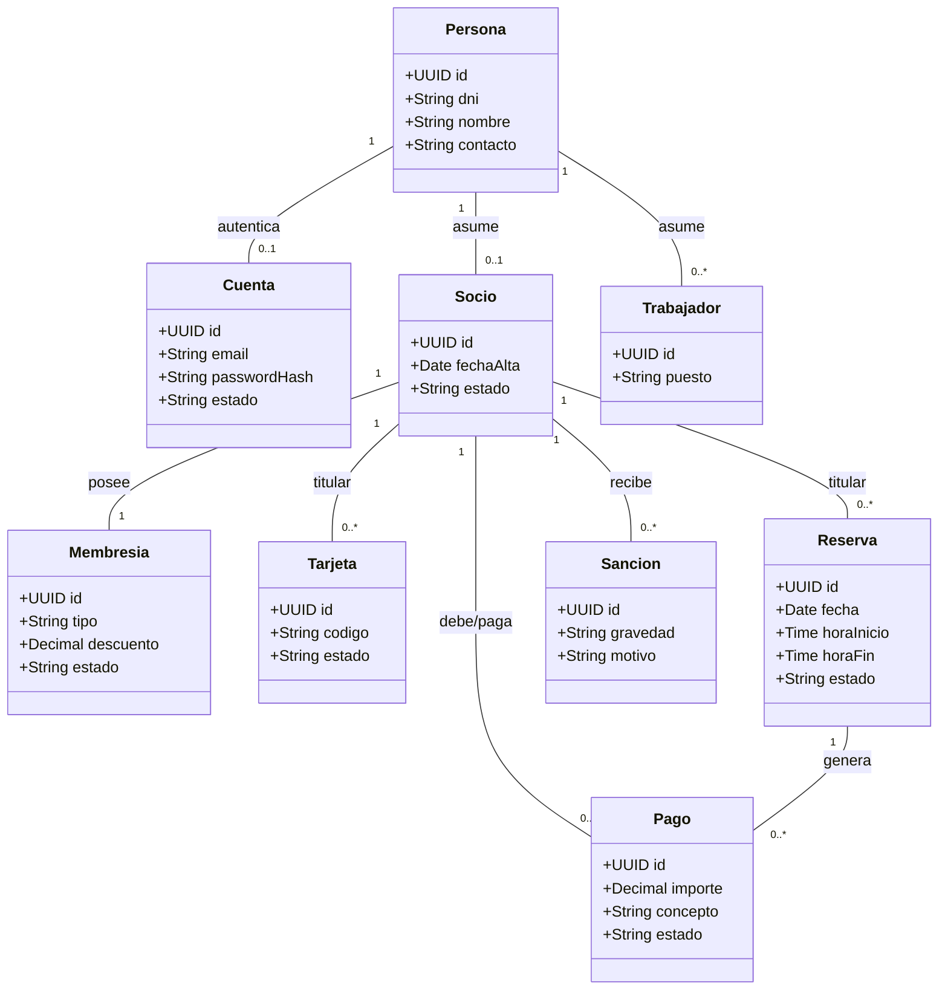

# Documento de Diseño: Modelo de Dominio — TFG v0.4

## 1. Objetivo y Alcance
El modelo de dominio representa la estructura lógica de la información del club deportivo. Separa estrictamente la identidad de los usuarios de su relación contractual y de sus credenciales de acceso. Su alcance incluye la gestión de usuarios, membresías vitalicias, control de acceso (simulado por software), reservas, pagos y sanciones disciplinarias. Quedan excluidos los pagos mediante pasarelas bancarias externas, asumiendo que el sistema liquida internamente las deudas o simula la transacción.

## 2. Entidades Principales y Responsabilidades
- **Persona:** Identidad física (DNI, nombre, contacto). Centraliza los datos para evitar duplicidades si asume varios perfiles.
- **Cuenta / Rol:** Credenciales de autenticación (email único, hash de contraseña) y autorizaciones del sistema.
- **Socio / Trabajador:** Relaciones operativas con el club. Una misma persona puede poseer ambas.
- **Membresía:** Estado comercial del socio (Básica, Premium, Honor).
- **Reserva:** Derecho temporal de uso de una instalación. Pertenece a un único titular (los acompañantes no se registran).
- **Instalación:** Espacios del club (Pistas, Fitness) con gestión de disponibilidad y mantenimientos.
- **Pago:** Registro centralizado de transacciones económicas (cuotas, reservas, deudas).
- **Sanción / Suspensión:** Medida disciplinaria que puede restringir servicios o revocar membresías.
- **Tarjeta / RegistroAcceso:** Control IoT para entradas físicas y verificación de identidad en el acceso.

## 3. Diagrama de Clases del Dominio

## 4. Reglas de Negocio Definidas
**Membresías y Descuentos:**
- **Básica:** 0% de descuento. Vitalicia desde el alta.
- **Premium:** 10% de descuento. Vitalicia tras confirmación de pago inicial.
- **De Honor:** 20% de descuento. Vitalicia y otorgada automáticamente al cumplir 10 años ininterrumpidos como socio.
- **Ofertas:** Las promociones puntuales no se acumulan con las membresías; el sistema aplica automáticamente el porcentaje que resulte mayor y más beneficioso para el socio.

**Deudas y Sanciones (Faltas):**
- Un pago en estado "pendiente" (ej. penalizaciones por reserva) bloquea automáticamente al socio para el uso de servicios y nuevas reservas.
- El socio puede liquidar el pago pendiente directamente desde la aplicación.
- La generación de impagos por no presentación o cancelaciones tardías registra automáticamente una sanción tipificada como "Falta Leve" en el historial del socio.

**Ausencias y Cancelaciones (Reservas):**
- Cancelación > 24h: 0% de recargo.
- Cancelación mismo día: 75% del importe (generando un pago pendiente y una falta leve).
- Ausencia (No-Show): Se otorga un margen de cortesía. A los 15 minutos de iniciada la reserva se envía una notificación. Al finalizar la franja sin registro de entrada IoT, se cobra el 100% (pago pendiente y falta leve).

**Control IoT (Simulado):**
- El titular tiene un margen de ±2 minutos para acceder físicamente a la instalación.
- Dado que no habrá hardware físico real, se desarrollarán endpoints específicos en el backend o scripts en el módulo de gestión (Desktop) para emular la lectura de tarjetas y testear la lógica de los tornos/puertas.

## 5. Decisiones de Diseño Justificadas
Se ha unificado la gestión económica mediante una única entidad `Pago`, que abstrae la naturaleza de la deuda (ya sea por adquisición de membresía, uso de pista o penalización disciplinaria). Esto evita acoplar el modelo financiero a entidades dispares y permite bloquear los servicios del usuario consultando un único repositorio de deudas.

La resolución de conflictos entre membresías vitalicias y ofertas temporales se gestiona mediante una política del mayor beneficio porcentual, lo cual simplifica la lógica de precios y previene cálculos en cascada que podrían generar importes nulos o negativos. Por último, la ausencia de hardware físico se solventará mediante emulación por software conectada directamente a la API de acceso, garantizando que el sistema central valide la entrada exactamente igual que si recibiera la trama de datos de un lector RFID real.